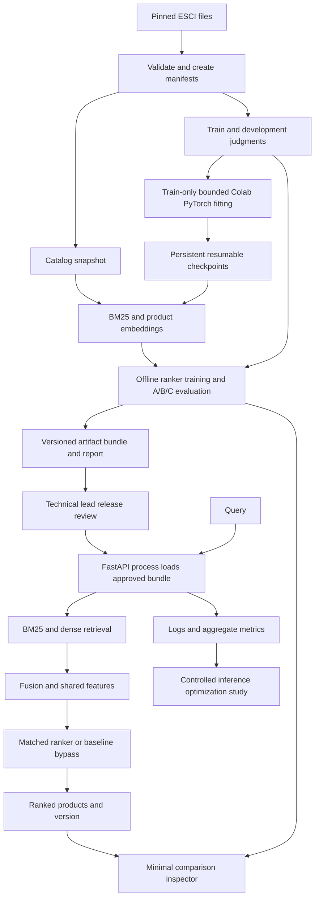

> Current status, 2026-11-05. M5 supervised training and M6 returned-model/saved-ranking checks are verified. The M7 real-model HTTP gate passed on DSMLP with exact offline/HTTP features and predictions. Docker fixture checks passed separately. The user accepted M7 on 2026-11-05. M8 has not started. See [the M7 review](reviews/M7.md). Earlier status sections below are historical records. Source publication to the user-designated Atlas repository is authorized. Data, models and generated artifacts remain private, and GitHub Actions remains manual-only.

> 2026-10-29 update: full GPU encoding/return is verified. The Mac phase stopped on OpenMP and is abandoned. The user authorized Colab CPU preparation and development-only transfer/bounded checks; full CPU evaluation awaits exact configuration approval. See [CPU readiness](reviews/M4.cpu-readiness.md). This changes the execution location, not module boundaries, retrieval logic or evaluation definitions.

> 2026-10-29: [Full-catalog encoding and Colab CPU FAISS/development A/B evaluation](reviews/M4.cpu-run.md) were accepted as the frozen pretrained baseline. M5 experiment preparation is authorized; training awaits a separate pilot approval.

# Proposed system architecture

Status: v0.5, architecture approved; M3 committed as 2409da6. M4's full-catalog pretrained embeddings, native Linux FAISS index and development evaluation are accepted as the frozen baseline. M5 preparation is authorized, with training pending reviewed pilot approval. Colab provides CUDA inference and Linux CPU evaluation. The Mac remains primary development/serving, but its native Torch/FAISS OpenMP conflict is unresolved and the full Mac import path was abandoned. See [M4 execution evidence](reviews/M4.cpu-run.md) and historical [full-run operations](M4_FULL_RUN.md). Full Linux CI remains unverified.

## Data flow

The locked test evaluator runs only in the single approved M10 final evaluation after all selected model and optimization configurations are frozen. Encoder/ranker fitting uses training judgments; development judgments support selection and reporting only. Training, serving, and the minimal inspector never load test judgments. MVP acceptance uses development data. No MLflow availability is required to answer a search request.

## Module boundaries

| Proposed path | Responsibility and boundary |
| --- | --- |
| `src/atlasrank/tracking.py` | M1 local SQLite/artifact smoke check; no model training |
| `src/atlasrank/data/` | Validate schemas, joins, duplicates, locale, and immutable manifests |
| `src/atlasrank/retrieval/` | BM25, encoder adapter, FAISS, fusion; return product keys and scores |
| `src/atlasrank/features/` | Shared offline/online query-product features; no labels or split IDs |
| `src/atlasrank/training/` | M5 PyTorch dual encoder and M6 ranker; fit on training judgments only |
| `src/atlasrank/evaluation/` | Tracks A/B/C, paired comparisons, slices, report generation |
| `src/atlasrank/artifacts/` | Bundle schema, checksums, compatibility validation |
| `src/atlasrank/serving/` | FastAPI schemas, orchestration, readiness, instrumentation |
| `benchmarks/` | Fixed workloads, stage profiling, controlled reference/variant experiments |
| `demo/` (M10 required) | Thin local comparison inspector using API results and saved reports |
| `configs/`, `tests/`, `docs/` | Reviewed configuration, fixtures/checks, contracts and reports |

Use `(product_locale, product_id)` as the product identity. Join features and scores by identity, never by row position. Retrieval exposes `search(query, k)`; ranking accepts candidate records and returns scored records. Keep request state isolated from loaded models.

## Supervised training and lineage

After M4 verifies lexical, pretrained dense, and hybrid retrieval, M5 fine-tunes both sides of the compact PyTorch dual encoder from a pinned pretrained initialization. The approved design uses a shared-weight MiniLM query/product encoder. The sampler, summed-positive loss, checkpoint/resume path, and thin Colab caller are implemented in the package; the train-only export and an unapproved pilot manifest are prepared. M2 defines admissibility fixtures and verifies XGBoost NDCG linear gains with no model fitting; M5 validates the actual sampler, loss, masks, gradients, and deterministic resume locally before GPU execution. Colab notebooks call repository training modules; keep modeling logic in the package.

The proposed pilot uses one NVIDIA L4, 3,600 seconds cumulative allocation, at most 2,700 seconds active training and 574 optimizer steps; it also caps VRAM, host RAM/RSS, scratch, persistent checkpoint storage, and transfer sizes. The 6-hour overall estimate is provisional; approve a cumulative budget separately after pilot evidence. Before any GPU allocation, approve the exact manifest and private persistent checkpoint destination. Save model, optimizer, scheduler, Python/NumPy/Torch CPU/CUDA RNG states, sampler cursor, configuration, hashes, and provenance outside temporary runtime storage. Local M5 resume fixtures use active dropout and a declared 1e-7 tolerance. Local MLflow exists from M1; export run metadata and artifacts for local inspection without a public tracking server.

Re-embed the same complete catalog for each trained encoder; build a new exact FAISS index and matching bundle. Fit an encoder-specific ranker on training features in M6. Preserve the pretrained path for controlled comparisons and rollback. A failed experiment never silently replaces the baseline.

## Exact offline/online feature parity

Treat the feature matrix immediately before `ranker.predict` as a versioned interface. Offline evaluation and HTTP serving must independently reach that boundary using the same query, product keys, bundle, preprocessing, and CPU reference runtime. Compare ordered names, dtypes, missing-value masks, identity mapping, and every feature value exactly, with zero tolerance.

CI runs both entry points with an immutable fixture bundle and deterministic encoder inputs. Include Unicode/whitespace queries, missing text, tied scores, permuted candidate order, serialization, and different request batches. Capture the actual serving matrix, not a second call to the shared helper. A deliberate feature-order or normalization mismatch must be detected. Keep approximate prediction checks separate; cross-device score tolerances cannot waive the exact reference feature contract. [Evaluation details](EVALUATION.md).

## Technology choices

- Python and Parquet, with Polars for data processing. Avoid Spark at this scale. Pin a supported Python version and dependency lock after Mac/Linux compatibility checks in M1.
- An in-process BM25 library, provisionally [`bm25s`](https://github.com/xhluca/bm25s), behind an adapter. Review its packaging and scoring semantics in M1 before adoption. Record analyzer, field construction, `k1`, and `b`.
- PyTorch plus Sentence Transformers for the compact encoder. Proposed baseline: [`all-MiniLM-L6-v2`](https://huggingface.co/sentence-transformers/all-MiniLM-L6-v2), pinned by revision. Its model card documents 384-dimensional vectors. Start with title-only product text and the model's documented truncation; record every tokenization setting.
- CPU FAISS `IndexFlatIP` over normalized vectors. This gives exact cosine retrieval and an oracle for future ANN experiments. FAISS documents storage as `4*d` bytes per vector: 1 million 384-dimensional vectors need about 1.43 GiB for vectors alone. Metadata, lexical indexes, and encoding buffers add memory. [FAISS index documentation](https://github.com/facebookresearch/faiss/wiki/Faiss-indexes).
- CPU XGBoost `rank:ndcg`, local MLflow using SQLite metadata and local artifact storage, FastAPI, Docker, Pytest, Ruff, mypy, and GitHub Actions. Add each dependency only in its milestone.

## Serving and artifacts

One CPU process loads one complete bundle at startup. Proposed endpoints: `POST /search`, `/health/live`, `/health/ready`, and aggregate `/metrics`. Bound query length and `top_k`; return explicit errors for invalid inputs and unavailable bundles. Scores are model scores, with method identifiers, and aren't relevance probabilities.

A bundle contains the encoder revision or weights, tokenizer configuration, product snapshot, lexical/vector indexes, product-row mapping, feature schema, ranker, and checksummed manifest. Include data/split versions, code revision, dependencies, metric-contract version, and experiment run IDs. Write bundles to new locations; never mix a new ranker with an old encoder or index.

Serving reads bundles only. Start with explicit restart-based bundle selection; validate compatibility before readiness. Portfolio completion requires a controlled failure and measured restart with the previous complete bundle in M10. Zero-downtime or automatic rollback needs a separate design.

Record request ID, bundle ID, candidate counts, stage durations, status, and error type. Use bounded metric labels, excluding raw query text and product IDs. No raw queries in logs by default.

## Required inference study and minimal inspector

M8 establishes reference profiling for encoding, lexical/vector search, fusion, features, reranking, queue time, and end-to-end latency. M9 selects one bottleneck and tests a bounded intervention, such as reranking depth, batching, or precision. Preserve reference bundles and workload hashes; evaluate quality as well as performance and document concurrency failures. Report rejection when the intervention doesn't justify adoption. The [evaluation contract](EVALUATION.md) defines controls and gates.

The required minimal portfolio inspector compares approved bundles sequentially through the API or reads immutable comparison reports; it doesn't add a ranking service. Display actual product ranks, method/bundle IDs, development judgments when available, and measured timings. Distinguish single-request timing from controlled benchmark percentiles and never manufacture values for an unrun model. Keep demo traffic outside benchmark runs. Limit it to one local view, two selected pipelines, top-10 products, bundle IDs, measured timings, and available development judgments; no accounts, dashboard suite, cloud deployment, or duplicated ranking logic. M10 must verify one reproducible displayed comparison against recorded API/report outputs.

Kubernetes, Kafka, distributed GPU infrastructure, and unrelated features remain excluded unless measured evidence supports a separate approved design.

## Resource boundaries

CPU is the reference serving backend, including Linux containers. Treat Colab CUDA as a separate inference/training execution environment; MPS remains optional and unrun. Preserve separate CPU/CUDA recipes and measure cross-environment numerical differences before adoption. M1 records actual RAM, available disk, package compatibility, and a proposed process-memory ceiling before any full build. If the full US snapshot doesn't fit, stop for approval of a versioned smaller corpus and revised evaluation scope.
