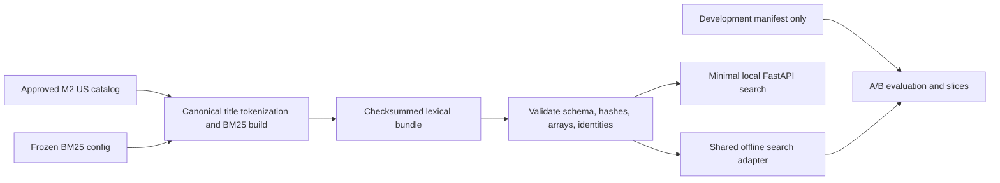

# M3 engineering review

Status: v0.3. The lead approved the audited staged candidate, and local commit `2409da693cd3cbe43e12c408120618ca02308c1a` was created with subject `Add reproducible BM25 search and development baselines`. The precommit sections and JSON records below retain their historical state. M4 planning now follows [M4_PLAN.md](../M4_PLAN.md); resource execution awaits review. Linux runtime/CI remains unverified and deferred. No remote, publication, training, GPU job, or official test evaluation occurred.

## Scope and authorization

The lead explicitly approved M2 commit `3f4e2d9ce3409d05134d971fb6e0d90bdb684446`, satisfying the commit gate before M3. Initial Git state had that HEAD, no remote, and a new untracked `.serena/project.yml`. That tooling file was left untouched; `.serena/` is now ignored.

Before implementation, the agent presented a single-configuration plan: title-only BM25; shared NFKC/casefold/Unicode-token analysis; fixed `k1=1.5` / `b=0.75`; deterministic product-key ties; versioned local bundles; a minimal API; golden/failure tests; and A/B development measurement within the existing resource limits. No tuning sweep was proposed or run. EVALUATION.md and the ESCI pins remain unchanged.

## Architecture and interfaces



`retrieval/analyzer.py` defines preprocessing. `retrieval/bm25.py` adapts pinned BM25S to stable identities, positive matches, deterministic boundary ties, candidate scoring, and save/load. `artifacts/lexical.py` validates the bundle before loading. `retrieval/jobs.py` implements bounded builds, guarded development evaluation, and basic latency measurement. `serving/app.py` loads one bundle and exposes local search/readiness. The existing controller/CLI gained explicit BM25 tasks and loopback serving; no new service architecture was introduced.

[LEXICAL.md](../LEXICAL.md) specifies fields, exact score formula, files, requests/errors, and reproduction commands. [configs/bm25.json](../../configs/bm25.json) freezes M2 audit/catalog/development hashes and the single pipeline `bm25-title-lucene-v1`. The reference bundle ID is `41e8286b586946eb4ec51ce105d4282ccd098316135c97f3501b6edeb76a6a7d`.

Only titles are indexed. All 1,215,854 US products remain; 5 nonempty titles yield no letter/digit tokens and contribute zero document length. IDF/average length use the entire catalog, never the judged candidate subset. The Lucene implementation omits the optional `(k1 + 1)` numerator factor; independent fixtures verify its score scale. Query labels don't participate in indexing.

The adapter returns up to 100 positive matches, preserving unknown-label results and never padding with unrelated zero-score documents. It resolves threshold ties by ascending product identity. Track A separately includes every judged candidate, including zero-score candidates. The API and evaluator share the adapter; actual score parity here doesn't establish the future M6 ranker-feature parity gate.

## Alternatives and decisions

| Choice | Alternatives | Decision and reason |
| --- | --- | --- |
| BM25 implementation | Custom math/index; another BM25 library; the architecture's provisional BM25S adapter | Use BM25S 0.2.14 with explicit NumPy/Lucene semantics. Inspect installed scoring code and verify independent fixtures rather than trust naming/defaults |
| Indexed text | Title only; concatenate descriptions/bullets/brand/color | Freeze title only for this baseline and the proposed title-based dense comparison. It limits memory and avoids an unregistered field/tuning sweep. No quality claim about excluded fields is made |
| Top-k ties | Library retrieval defaults; full catalog sort; threshold selection plus canonical tied IDs | Explicit selection preserves ties at k without a full product sort per request. Golden fixtures include 105 equal-scoring documents and k=100 |
| Serialization | Pickled Python object; native arrays only; native arrays plus schema/lineage/checksums | Use non-pickle arrays and Parquet identities, with exact inventory, version, parameter, shape/dtype/bounds, vocabulary, and identity checks before readiness |
| API | Separate ranking logic; thin shared adapter | One immutable bundle and shared scoring keep offline/HTTP behavior aligned. Missing or incompatible bundles stay unready; no query text is logged |
| Experiment scope | Tune multiple configurations; establish one fixed baseline | One predeclared configuration. Report its quality/limits and preserve all runs; M9 optimization and model promotion remain separate approval gates |

## Executed build and resource evidence

Two full builds completed, with byte-identical scores, mappings, manifest, and completion files. Full score-vector hashes for four fixed synthetic probe queries matched after fresh load. Original data, all four M2 preparations, both index builds, and all three development reports remain intact.

| Measurement | Actual result |
| --- | ---: |
| Catalog documents | 1,215,854 |
| Indexed title-token occurrences | 21,002,339 |
| Vocabulary terms | 386,328 |
| Nonzero term/document score entries | 19,261,640 |
| Empty-token title documents retained | 5 |
| Bundle size | 221,212,561 bytes (about 211 MiB) |
| Monitored build command, first / second | 19.72 / 15.95 seconds |
| Internal build/save timer, first / second | 18.13 / 14.79 seconds; excludes initial catalog load/sort |
| Sampled build peak child RSS, first / second | 864,436,224 / 1,450,360,832 bytes |
| Final evaluation command / inner query evaluation | 18.21 / 13.10 seconds |
| Final evaluation sampled peak child RSS | 1,326,399,488 bytes |
| Data root with all retained history | About 3.67 GiB |

The existing limits are 8 GiB preprocessing RSS, a 30 GiB local data reservation, 2 GiB free headroom, and the proposed 6 GiB serving process ceiling. Observed runs stayed within them. The controller samples RSS/disk; it isn't an OS hard allocation cap. The current data root includes datasets, preparations, index bundles, and per-query reports. Small validation/build logs remain separately ignored under `.local`.

These repeats prove local reproducibility, not a controlled build-speed improvement. Process/cache state differs, and power/thermal state wasn't instrumented. No future dense/index memory-fit claim follows from the lexical measurements.

## Development quality evidence

`docs/reviews/M3.metrics.json` (private evidence) records aggregate results, slice/denominator counts, interval settings, and workload/report hashes. Full per-query metrics/rankings remain under ignored `data/esci/reports/`. All 4,129 development query IDs/groups were included. No-E recall exclusions and zero-IDCG counts were both 0 on this snapshot; synthetic fixtures cover those cases.

| Track / measure | Observed value | 95% query-group mean interval |
| --- | ---: | --- |
| A NDCG@10 | 0.688226 | [0.681819, 0.694882] |
| A MRR@10 | 0.747987 | Not separately estimated |
| B known-exact Recall@20 | 0.283260 | [0.273788, 0.293171] |
| B known-exact Recall@100 | 0.433266 | [0.422364, 0.444233] |
| B judgment coverage@10 | 0.245353 | Not separately estimated |
| B judgment coverage@100 | 0.071661 | Not separately estimated |

The intervals use the approved 2,000 normalized-group resamples and seed 42. For a single baseline, the implementation uses a zero algebraic offset to estimate mean intervals, with no competing-model or improvement claim. They describe query sampling, not training variability.

B returned 404,929 positions at up to 100 per query. There were 102 short rankings, including 25 empty rankings; these queries weren't excluded or padded. Most retrieved products lack judgments: coverage@100 of 7.17% doesn't mean the other 92.83% are irrelevant. Known-exact recall uses only judged E products in its denominator. A's conditional ranking score doesn't establish full-catalog relevance quality. C's hybrid-to-learned-reranking pipeline is unimplemented and explicitly unrun. Official test judgments were never opened by M3 jobs.

All three development runs produced identical A/B metrics, slices, bootstrap intervals, and per-query product/score orderings. The semantic per-query digest, excluding timing, is `6cfa8df5b115417cfa31a98e833b8350bb1a19ecf05edf0974ff68256f2b44a7`. The first run's metric path was inefficient; its completed report remains preserved rather than replaced.

## Latency and actual HTTP evidence

Basic offline latency uses a hash-selected 200-development-query workload, 20 warmups once, and 3 sequential repetitions of top-100 search. It includes analysis, full catalog scoring, and deterministic selection. It excludes HTTP/JSON/queueing and runs with warm data/cache state after evaluation.

| Repetition | p50 ms | p95 ms | p99 ms |
| --- | ---: | ---: | ---: |
| 1 | 2.394 | 5.423 | 6.613 |
| 2 | 2.371 | 5.303 | 6.491 |
| 3 | 2.415 | 5.459 | 6.671 |

These are descriptive percentiles from 200 observations per repeat, not M8's load/concurrency study or production SLO evidence. The workload IDs and individual timings remain local; committed evidence includes their hash and aggregates. Environment: Apple M4/16 GB, macOS ARM64, Polars threads 2, OpenBLAS/OpenMP threads 1, Python 3.12.11. `docs/reviews/M3.environment.json` (private evidence) records actual dependency/hardware metadata.

`docs/reviews/M3.http.json` (private evidence) records a real Uvicorn process bound to `127.0.0.1`, loaded with the full bundle. Readiness took 1.24 seconds in that observation, with sampled serving RSS of 1,276,624,896 bytes. A search returned 10 products with exact offline/HTTP identities, titles, scores, and order. One client-observed HTTP request took 6.05 ms; it isn't a percentile or cold-filesystem measurement. Invalid top-k returned 422, an OOV query returned an empty 200 result, and query text was absent from the server log. The smoke server was terminated normally afterward. All development queries fit the API's query bounds.

## Commands and checks

Commands ran from the repository root with project-local uv caches; final checks also used `TMPDIR="$PWD/.tmp"`. `docs/reviews/M3.validation.json` (private evidence) records exact command outcomes, source/configuration hashes, artifact/report identities, local logs, and preserved history. No success is inferred from a workflow definition.

| Command/check | Executed outcome |
| --- | --- |
| `uv lock --python /opt/homebrew/Caskroom/miniforge/base/bin/python` / `uv sync --locked --group dev` | Passed; new packages BM25S, HTTPX, HTTPCore; existing locked versions preserved |
| `uv lock --check` / `uv pip check` | Passed; 109 locked packages, 106 compatible installed packages on this Mac |
| `uv run --locked python -m atlasrank bm25-build --output data/esci/indexes/m3-bm25-v1` and `m3-bm25-v2` | Both passed; byte-identical bundles |
| `uv run --locked python -m atlasrank bm25-evaluate --output data/esci/reports/m3-bm25-v1` through `m3-bm25-v3` | Passed; all semantic results identical, all history retained |
| `.venv/bin/python .tmp/m3_http_smoke.py` | Passed against an actual local server/full bundle; script/logs retained locally |
| `uv run --locked ruff check .` / `uv run --locked ruff format --check .` | Passed |
| `uv run --locked mypy` | Passed; 31 source/test/script files |
| `uv run --locked pytest` | 59 passed in 5.15 seconds; 2 retained deprecation warnings |
| Local MLflow `tracking-smoke` | Passed; fresh run/artifact export, existing history retained |
| `uv run --locked python scripts/audit_environment.py` | Passed; metadata observation only |
| `uv build --out-dir .local/builds/m3-final-v1` | Passed; source/wheel contents inspected for code/fixtures and absence of runtime artifacts |
| Git whitespace, local references, ignore rules, pins/manifests, and no-remote checks | Recorded in final validation evidence |

Synthetic tests cover independent BM25 arithmetic, normalization/field exclusion, repeated query terms, empty/OOV cases, input reordering, ties crossing k=100, exact save/load, concurrent request isolation, bad mapping/vocabulary/array shape/Parquet, missing/corrupt/version-incompatible bundles, guarded development jobs, no-E recall denominators, strict API errors, privacy, and HTTP/offline parity. They never read acquired data. Existing M2 metric/gain/supervision and M1 tracking tests still pass.

The tests retain Starlette's HTTPX TestClient deprecation warning and MLflow's existing SQLAlchemy `noload` warning. No warning was suppressed. Linux runtime, GitHub Actions, actual learned-model integration, dense retrieval, C evaluation, controlled load, and final test evaluation remain unrun.

The final file audit checked all 33 modified or untracked nonignored files: regular UTF-8 source/configuration/documentation only, no runtime artifacts or recognized credential patterns, no staged files, and no remote. Recorded source/configuration hashes still match. The global AGENTS.md imports `RTK.md` and `PROCESS.md`, but neither file was available in the repository, home directory, or `.codex`; their unavailable status is recorded in validation evidence.

## Failure modes and limits

- A wrong M2/config hash, existing output destination, invalid identity, or incompatible bundle fails closed. Previously built bundles and reports aren't deleted. Startup corruption leaves readiness/search at 503 while liveness remains 200.
- Checksums detect changed bytes; structural checks additionally reject correctly rehashed but incompatible schema/parameters, mappings, array shapes, or vocabulary. These aren't signed artifacts or a hostile-upload security boundary. Selection remains explicit and local.
- Tokenization can miss lexical matches or discard punctuation-only content. Five such documents remain in N, and 25 development queries retrieved no positive-score matches. One title-only baseline doesn't establish that other fields, analyzers, or models would improve relevance.
- Unknown judgments dominate retrieval results. Keep coverage/returned counts with known-exact recall; never reinterpret unknowns as negatives. M2 query grouping remains unchanged, with residual paraphrase/tokenization-collision risks documented rather than resplit.
- The minimal API has strict query/locale/top-k validation and safe expected errors. Full operational hardening, sustained memory/concurrency behavior, load studies, and M6 learned-ranker feature parity remain later work. No production readiness or deployment claim is made.
- Sampled resource guards can miss spikes; serving checks load-time peak rather than enforcing continuous OS limits. Measurements leave headroom but don't predict future model/index memory.
- Local dependency/ABI checks passed; Linux remains unverified. Ignore rules protect normal staging, while explicit force-adds and tracked-file changes still require review.

## Five technical questions and answer outlines

1. **Why does Track A use full-catalog BM25 statistics instead of rebuilding on each query's judged candidates?** The corpus/statistics are frozen. Refitting IDF/average length per candidate set changes the scorer and makes A incomparable to the retrieval/serving reference; held-out product text is allowed, held-out labels aren't.
2. **Which BM25 formula is actually implemented, and how do the independent fixtures distinguish variants?** Lucene log-IDF with `tf/(tf+k1*length_norm)`, float32, and no `(k1+1)` factor. Compute the 4-document fixture by hand, including the empty document in N/average length; compare magnitudes and ranking.
3. **Why is a plain partition-based top-k insufficient for deterministic search?** Equal scores at the cutoff can select arbitrary IDs. Determine the threshold, include all strictly higher scores, fill ties in canonical product-key order, then sort the selected rows. Reordering the input catalog must not change identities/scores/order.
4. **What must be checked before the API becomes ready?** Completion/manifest checksums, fixed dependency/analyzer/math versions, exact component inventory, sparse shapes/dtypes/bounds, and unique canonical US mapping. Missing/corrupt/incompatible bundles yield 503; invalid requests yield 422; raw query/error details stay out of logs/responses.
5. **What do Recall@100=0.4333, coverage@100=0.0717, and the timing results establish?** Known-E retrieval and query-sampling uncertainty under incomplete judgments, plus descriptive local warm sequential timings. They don't establish complete catalog relevance, model improvement, test performance, training variability, or production load/SLO behavior.

## Human-understanding checkpoints and development log

- Inspect the exact analyzer/formula and recompute the golden scores, including empty-token documents and repeated query terms.
- Trace a product identity through canonical indexing, sparse scores, serialization, tie selection, offline scoring, and the actual HTTP route.
- Inspect configuration/lineage and corruption/readiness tests; explain why startup integrity and procedural test-label protections have limits.
- Explain A/B differences, unknown-label coverage, recall denominators, bootstrap grouping, and the separation between M3 timings and later M8/M9 studies.
- Review the unchanged evaluation/source pins, resource/history evidence, and remaining Linux gap before approving M3 or authorizing M4.

The agent hasn't asserted lead understanding or M3 code approval. The lead owns those decisions.

The agent implemented the approved plan within existing module boundaries, pinned dependencies, added golden/failure/API tests, and produced local evidence. Initial line-length/format issues were corrected before final checks. A catalog dictionary-key view caused repeated full-set construction inside the existing metric helper; the adapter now caches an immutable set without changing metrics or BM25 scores. The first evaluation completed before an approved process lookup could stop it: sandbox process enumeration initially failed, the retried lookup found no matching worker, and no process was terminated by that lookup. All completed reports remain, and subsequent runs proved semantic equality. This engineering correction isn't an M9 optimization study or promotion claim.

The lead's M2 commit approval was recorded in scope documents while EVALUATION.md stayed byte-identical. No human corrections arrived during M3. No raw data/history was removed, no remote was configured, no artifact was published, and no M4 or learned-model work began. Stop here for technical-lead review.

## Conditional approval and precommit review

The complete implementation diff against approved M2 HEAD was reviewed, including every new Python module/test, configuration, dependency/lock change, and documentation/evidence file. No blocking inconsistency was found within the approved local M3 scope. Source/configuration hashes still match the executed M3 validation; the reference bundle's 8 component hashes and the frozen evaluation/ESCI pins remain unchanged. This agent review doesn't establish human understanding or code approval.

Scoring uses full-catalog Lucene IDF, positive term contributions, and shared title/query analysis. Canonical product rows make threshold ties deterministic, including selection at k=100. Serialization validates the completion record, manifest identity, fixed component inventory/checksums, dependency/scoring versions, sparse array structure, vocabulary, and product mapping. HTTP search uses the same adapter with strict validation and explicit readiness/errors. The review retains the documented Linux, trusted-local-artifact, sampled-resource, and minimal-API limitations.

The arithmetic check independently tokenized the 4-document fixture using plain string splitting and called the installed BM25S implementation directly, without the adapter or its test's arithmetic helper. Document lengths are `[3, 2, 2, 0]`, so N=4 and average length=1.75. For `apple`, df=2 and Lucene IDF is `log(2)=0.6931471805599453`. With k1=1.5 and b=0.75:

```text
a: log(2) * 2 / (2 + 1.5 * (0.25 + 0.75 * 3 / 1.75)) = 0.32212649055067993
b: log(2) * 1 / (1 + 1.5 * (0.25 + 0.75 * 2 / 1.75)) = 0.2605116920225298
c,d: 0
```

Actual float32 scores were `[0.32212647795677185, 0.26051169633865356, 0, 0]`; maximum absolute error was about 1.26e-8, within rtol=1e-6 / atol=1e-8. The empty document participates in N and average length. Multiplying by the optional `(k1+1)=2.5` factor fails the comparison, distinguishing the selected variant from that convention.

Five development cases were purposefully selected from the saved final report to inspect distinct failure modes. They aren't a random sample or a frequency estimate. Fresh searches exactly reproduced their saved top-100 product identities, scores, and order. The guarded development loader and pinned catalog were the only data sources; raw examples and test judgments weren't opened. Raw query text, catalog excerpts, known-E examples, and detailed observations stay in ignored `.local/validation/m3-precommit-v1/development-errors.json`.

| Development query ID | Returned / known E | Observation |
| --- | --- | --- |
| 5504 | 0 / 9 | The compound query token is absent from title vocabulary. A judged-E title uses a hyphenated form that splits into 2 tokens, and another uses a different written name. Alias/punctuation differences aren't bridged. The varied E pool also limits confident intent claims |
| 72474 | 0 / 7 | The query spelling is absent from vocabulary; several judged-E titles contain a nearby spelling. No spelling correction occurs. Other E products have different wording, so intended product identity remains ambiguous |
| 128570 | 0 / 9 | The non-Latin token is absent from title vocabulary, while judged-E titles include English reading-glasses wording. Unicode token retention alone supplies no translation or multilingual semantic matching |
| 319 | 100 / 6 | All known E products were missed at 100. A supplement title ranks first through exclusion-related word matches; tea titles follow. Additive matching doesn't enforce product type or interpret requested exclusions |
| 502 | 100 / 3 | All known E products were missed at 100. Top results are a radiator, shock absorbers, and a tuner sharing vehicle/year tokens; the requested part token is absent from those titles. Judged-E examples match the part token but omit the vehicle tokens |

Known-exact Recall@100 is 0 for all 5. The nonempty cases have judgment coverage@100=0, so their retrieved products remain unknown under the evaluation contract. Visible title drift is a diagnostic observation, not a newly assigned relevance label. No labels, analyzer, fields, parameters, rankings, or evaluation definitions were changed.

The precommit command record includes fresh lock/dependency, Ruff, formatting, mypy, fixture-test, and Git whitespace checks; all passed, including 59 tests with the same 2 deprecation warnings. The staged allowlist has 34 changed/new files, and the resulting index has 70 regular UTF-8 files. Auditing the staged blobs found no datasets, weights, checkpoints, indexes, local databases, runtime logs, sampled raw development-query text, or known credential patterns. Runtime/secret ignore probes passed while source packages remained trackable. EVALUATION.md and ESCI pins equal HEAD; no remote exists. The heuristic secret scan has the usual limits, and force-add can bypass ignore rules.

The proposed commit subject is `Add reproducible BM25 search and development baselines`. Staging is a review preparation step; commit creation and M4 execution remain gated by the lead's requested approvals. Full-catalog dense encoding will require the separately reviewed resource plan.
