> Historical training-only report. Later manual retrieval work and its evidence limits are consolidated in [M5.5](M5.5.md) and [M5 status](M5.md). Original training measurements below are preserved.

# M5 training execution v0.1

**Training completed; retrieval improvement is unmeasured.** The authorized L4 run passed its ten-update sanity check and continued the same optimizer, scheduler, RNG stream and sampler cursor to **574 updates over 9,180 training groups**. The final checkpoint and model are back on the Mac and independently verified. M5 remains incomplete until matching trained-catalog retrieval comparisons are executed. No model promotion, official test evaluation, catalog re-embedding or M6 work occurred.

## Experiment and execution

The experiment retained the shared-weight MiniLM initialized from `sentence-transformers/all-MiniLM-L6-v2` revision `1110a243fdf4706b3f48f1d95db1a4f5529b4d41`. Training used only the approved E positives and admissible same-query I negatives, with at most two positives and four negatives per group; products marked E anywhere in training remained excluded from negatives. No S/C/unknown supervision, random-catalog or cross-query in-batch negatives, development-label supervision or test judgments were introduced.

The summed-positive log-sum-exp objective, temperature 0.05, float32, AdamW learning rate 2e-5, weight decay 0.01, 29 warmup updates, linear decay and clipping norm 1.0 stayed fixed. Microbatch 8 / accumulation 2 retained effective batch 16; the last twelve-group window used 8/12 and 4/12 loss weights. There was one deterministic pass, no sweep and no optimization study.

```mermaid
flowchart LR
    A[Approved train-only groups and frozen sampling plan] --> B[Private Drive inputs staged on CPU]
    B --> C[Shared MiniLM query/product towers on L4]
    C --> D[Summed-positive loss and weighted accumulation]
    D --> E[Ten-update sanity and immutable checkpoint]
    E --> F[Same optimizer state through update 574]
    F --> G[Drive checkpoints, model export and progress logs]
    G --> H[Colab CPU checks and independent Mac validation]
```



Inputs were staged and checksum-verified in private Drive before GPU connection. Execution used a fresh `AtlasRank/m5/training-l4-v1` directory, preserving both earlier failed destinations. Runtime discovery verified NVIDIA L4, Python 3.13.16, Torch 2.11.0+cu130 and CUDA 13.0. The pinned overlay used `venv --without-pip --system-site-packages`; pip worked and native CUDA Torch remained unchanged.

At update ten, the package checked finite loss/gradient norm, unchanged memory safeguards and changed finite model weights, saved a full checkpoint, and then continued within the same process. The check does not consume training examples or advance RNG. Subsequent checkpoints were written at 100, 200, 300, 400, 500 and 574. Sequential completed-update records independently confirm cursors 1–574 and 9,180 consumed groups. The last effective batch contained twelve groups.

## Actual results

| Measurement | Executed result |
| --- | ---: |
| Completed optimizer updates | 574 |
| Query groups | 9,180 |
| Mean of update losses | 0.702527 |
| Query-count-weighted epoch loss | 0.702472 |
| First 100 / last 100 update mean | 0.737748 / 0.682150 |
| Raw gradient norm range, before clipping | 3.222958–20.699804 |
| Training-loop time, including logging/checkpoints | 298.010 s |
| Update throughput | 1.9261 updates/s |
| Model load / token fingerprint validation | 14.027 s / 18.534 s |
| Checkpoint time, including sanity checkpoint | 15.703 s |
| Durable diagnostic logging time | 11.936 s |
| Runner time | 331.351 s |
| Peak allocated / maximum reserved GPU memory | 4.8067 / 9.4551 GiB |
| Minimum observed free GPU memory | 12.1074 GiB |
| Maximum observed phase RSS / end RSS | 1.7802 / 1.7924 GiB |
| Final checkpoint | 271,530,607 bytes |
| Trained safetensors weights | 90,864,192 bytes |
| Returned verification bundle | 365,596,388 bytes |

Checkpoint and diagnostic times are included in training time; they must not be added again. The framework peak records and observed free memory satisfy the unchanged 10 GiB allocated cap and 8 GiB free floor. No memory fallback or hidden batch/precision change occurred. RSS observations satisfy the 12 GiB limit; launch available RAM was 54,654,758,912 bytes. True process RSS between observations was not independently profiled.

| Update window | Mean training loss |
| --- | ---: |
| 1–100 | 0.737748 |
| 101–200 | 0.732548 |
| 201–300 | 0.710530 |
| 301–400 | 0.675605 |
| 401–500 | 0.647450 |
| 501–574 | 0.714360 |

The first ten updates averaged 0.710291. First and last individual losses were 0.813711 and 0.828747. Different windows contain different query groups, so the trajectory is neither monotonic nor a controlled repeated validation set. It demonstrates executed learning, finite gradients and updated weights; it does not establish better retrieval.

## Artifacts and independent checks

| Artifact | SHA-256 |
| --- | --- |
| Executed source/input bundle v8 | `82e7b062eb50e229a541aa57edd131f1f9318b1661478fe00cfa8c36cb1ec596` |
| Returned bundle | `f141dbacc0c363b125dd2c30a665ff22ad0a2d53b860e73dbdb88f712c3b76c7` |
| Final optimizer checkpoint | `2b2d042cc7555d39851431a8eb0c12aadad60f700778f27b36bc04a7fe998126` |
| Trained model weights | `42bfed57ca7c73e457040154aff8c88d6dc4248938e90c08c19e2617a16a2b23` |

The original approved v6 bundle remains untouched. The executed v8 repack changed only `training/configuration.py`, `training/runner.py` and `EXPORT.json`; every other member, including training examples, sampling plan, base model, loss, tokenizer and model implementation, was byte-identical. These operational changes enable the newly authorized schedule and its sanity check. The original sampling-plan hash remains `8876820add0a81fddb345779ab474fc057a9d3a64474a495ea2b7581cbabc382`.

All seven checkpoint hashes were verified on Colab CPU. The Mac independently verified the returned bundle, every returned member, the final checkpoint receipt, model archive inventory, source/manifest/evaluation pins, update sequence and loss/memory records. Other checkpoint weights remain in Drive; only their receipts and the final checkpoint were returned, keeping transfer below 512 MiB.

The final checkpoint loads on CPU with optimizer steps exactly 574, scheduler epoch 574 and final LR zero. Python/NumPy/CPU Torch/one-device CUDA RNG states are present; CPU RNG remains a CPU tensor. All weights and optimizer moments are finite. All 101 learned parameter tensors changed from initialization; maximum absolute change is 0.00325450 across 22,713,216 parameter values. Checkpoint and safetensors parameter values match exactly.

SentenceTransformers 6.1 canonicalizes module paths and mean-pooling configuration and omits the nonpersistent `embeddings.position_ids` buffer. Initial schema/byte-equality assumptions in the local inspection failed on those serialization differences. The trained artifact was not modified: verification explicitly checked the original position-ID range, identical BERT settings, exact fixed-length token IDs/masks/types on five label-free texts, and equal loaded module classes and pooling configurations. Both original and saved models load through the existing adapter. The saved model produces finite normalized 384-dimensional vectors on the CPU fixture, with maximum norm error 1.19e-7. Export-versus-checkpoint outputs are bitwise equal on that same CPU fixture.

Private local artifacts are under `.local/colab/m5-training-return-v1/`; the final checkpoint is `checkpoints/3c8bfa95e4af4447b11784af387fb2c9/step-000574.pt` and the model is `model-bundle/model/`. Approved settings and owner tokens remain ignored/private. No files are staged, committed, pushed or published.

## Allocation and release evidence

The user explicitly superseded earlier execution restrictions, authorized sanity-then-full training and instructed that earlier allocations be excluded from this run's practical limit. Existing memory/storage/transfer safeguards remained fixed. This run used a standalone 3,600-second allocation cap, 2,700-second active cap and 300-second finalization reserve, allowing the requested longer setup period.

The package end receipt records 621.359 seconds. The completion cell verified status `completed` and update 574, then called `runtime.unassign()` at 622.982 seconds. An independent UI check showed “Reconnect L4 High-RAM”; the conservative charge through that observation is **650.723 seconds**. These are wall-clock observations, not provider billing telemetry. The GPU was released before CPU packaging and local checks. The CPU verification session was retained for inspection.

The original 1,944.793749-second failed attempt, 423.215214-second setup stop and intervening sessions with unresolved durations remain preserved. Their known subtotal plus this conservative charge is 3,018.732208 seconds, excluding unresolved usage. No complete historical cumulative-budget compliance claim is made. No future GPU job or six-hour total budget is implicitly approved.

## Validation commands and outcomes

Focused Pytest: **41 passed, one skipped in 1.81 s**. Tests cover the existing admissibility/loss/order/accumulation/dropout-resume fixtures, timing-boundary behavior, unchanged hyperparameter rejection and sanity rejection for unchanged/nonfinite weights, nonfinite loss/gradient or unsafe memory. The skipped test is actual CUDA interrupted/resume parity. This real run was uninterrupted; checkpoint state completeness is not a substitute for an executed CUDA resume test.

Executed local checks:

```text
uv run ruff check src/atlasrank/training/configuration.py src/atlasrank/training/runner.py tests/test_m5_training_sanity.py
uv run mypy --strict src/atlasrank/training/configuration.py src/atlasrank/training/runner.py tests/test_m5_training_sanity.py
uv run pytest -q tests/test_m5_training_sanity.py tests/test_m5_retry_budget.py tests/test_m5_accumulation.py tests/test_m5_operational.py tests/test_m5_budget.py tests/test_dual_encoder_training.py tests/test_training_export.py
python3 .local/colab/verify_m5_training_return.py
.venv/bin/python .local/colab/check_m5_saved_state.py
.venv/bin/python .local/colab/check_m5_saved_tokenizer.py
```

Ruff and strict mypy passed. The return import is deliberately single-use and refuses to overwrite an existing directory. Saved-model CPU construction, strict checkpoint loading and five-text output parity also passed. Full Mac Torch/FAISS validation was not retried; its OpenMP failure and dependencies remain unchanged. Full Linux CI and MPS remain unrun. CPU loading emitted existing SentenceTransformers deprecation and macOS multiprocessing redirect notices; no dependency repair was attempted.

## Decisions, alternatives and remaining risks

- Batch 16 without accumulation previously failed its free-memory guard. Microbatch 8 / accumulation 2 was retained instead of changing the effective batch or schedule. Its real GPU memory behavior now passes; dropout batching is not bitwise equivalent to the older batch-16 attempt.
- Stopping at ten and restarting a second process would require reloading and restoring state. The chosen in-process sanity gate continues the same state without replay; an immutable step-ten checkpoint remains available.
- The earlier 300-second setup gate stopped before training. CPU staging plus the newly authorized practical limits avoided repeating the upload on paid GPU time. Previous failures and proposals remain unchanged.
- Actual CUDA interrupted/resume, trained-model CPU/CUDA inference agreement, full-catalog index compatibility and retrieval quality remain unmeasured. Saved-model CPU checks establish bounded load/output correctness, not FAISS compatibility or model promotion.

To obtain retrieval evidence, pin this trained model as a new artifact, run a bounded cross-device encoding check, re-embed the complete canonical 1,215,854-product catalog with the existing immutable-chunk pipeline, construct a matching native Linux CPU FAISS IndexFlatIP, and run the frozen development-only Tracks A/B for trained dense and RRF-60 hybrid against M3 BM25 and M4 pretrained dense/hybrid. Preserve identities, source hashes, unknown-judgment policy, metrics and paired comparisons. Pretrained embeddings cannot be reused with changed encoder weights. These executions have not begun.

## Engineering understanding

1. **Why sum positive probabilities?** The approved loss subtracts log-sum-exp over all E positives from log-sum-exp over admissible candidates; it does not average independent positive cross-entropies or introduce other queries' negatives.
2. **Why 8/12 and 4/12 in the last window?** Each microbatch contributes its share of twelve groups. Equal halves would overweight the smaller microbatch; optimizer, scheduler and cursor advance only once.
3. **What makes a checkpoint sufficient for recovery?** Model, optimizer moments, scheduler, sampler cursor, RNG and provenance are present and checksummed. Actual CUDA resume parity remains a separate unrun check.
4. **Why report free, allocated and reserved memory?** Driver free memory determines headroom; Torch reserved memory includes cached blocks. Passing allocated-memory alone would not prove the 8 GiB free floor.
5. **Why is lower training loss insufficient?** Query difficulty varies and training supervision differs from catalog retrieval. Changed weights require matching catalog embeddings/indexes and frozen development comparisons before any improvement claim.

Human review should confirm the loss, final-window weighting, uninterrupted continuation, artifact identity and distinction between completed training and measured retrieval improvement. Generated explanations do not establish human understanding.

AI-generated changes were confined to the existing runner/configuration, focused tests, thin notebook and execution documentation. The user's correction removed further preparation gates and authorized completion of the ML experiment. No architecture, model, loss, sampler, training data, optimizer hyperparameter or evaluation-contract changes were made. See structured evidence (`docs/reviews/M5.training.validation.json`, private evidence) for exact pins and observations.
