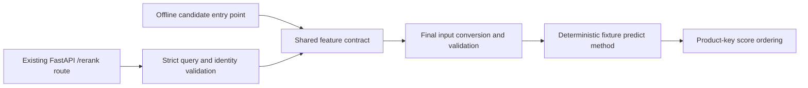

# M6 shared features and prediction-boundary parity v0.1

Status: implemented for review; uncommitted. This is the approved first phase of
[M6.ranking.plan.md](M6.ranking.plan.md). It implements the five-feature contract and
independent offline/HTTP parity using an explicitly permitted deterministic test
predictor. **No ranker was fitted. Actual XGBoost DMatrix/prediction-boundary validation
remains a gate**, following a preserved native Mac libomp crash described below.

## Implemented contract

The versioned [schema](../../configs/ranking-features-v1.json) and
`features/ranking.py` define these exact ordered float32 columns:

| Column | Computation |
| --- | --- |
| `bm25_score` | Frozen full-corpus Lucene BM25 candidate score, including genuine zeros |
| `dense_cosine` | Existing native IndexFlatIP subset score for the encoder-matched unit vector; no clipping |
| `title_query_token_overlap` | Jaccard of unique analyzer token sets; empty union → 0 |
| `query_token_count` | Frozen analyzer count including repeated tokens |
| `title_token_count` | Frozen analyzer count including repeated tokens |

Query normalization/analyzing and encoder calls reuse existing modules. Original query
text is forwarded to the frozen scorer/encoder, which own their preprocessing; this
layer does not add an extra preprocessing pass. IDs, labels,
row positions, split flags and source retrieval ranks never enter numeric predictors.
Canonical rows sort by `(product_locale, product_id)`. Candidate input order and its
row mapping are retained; permuting candidates changes neither features nor identities.
Values are C-contiguous float32 and read-only. Explicit bool numeric-missing masks
have shape (N,5); this complete schema requires finite scores and all-false masks.
Separate (N,2) flags record normalized-empty query/title text. A punctuation-only title
can have zero analyzer tokens without being an empty string. Missing text maps to the
approved empty string; its actual dense embedding is still scored.

Absent, duplicated, unknown-identity or non-finite required scores fail. Genuine BM25
zero scores and genuine cosine zeros remain valid. No score is filled from absence in
a top-100 list. Feature provenance binds schema, lexical/dense artifact IDs, original
catalog SHA and canonical title/identity content digest, query/product recipe IDs,
model revision, weight SHA, dimensions and model identity covering the full pinned
model/tokenizer file inventory. Incompatible catalog, identities, model or tokenizer
bindings fail before features are used.

`DenseBinding` is a trusted descriptor, not HTTP input. For actual neural bundles it
must be constructed only after existing full bundle/source/vector validation. This
phase constructs it from tiny explicit fixtures; it does not establish real-bundle
integrity by accepting supplied metadata. Full catalog/title compatibility is checked
at construction/readiness; the query path rechecks encoder/source recipe identity
without re-hashing the entire title catalog per request.

## Actual paths and final predictor boundary



`evaluation/ranking.py:offline_predict` and `serving/ranking.py:RankingRuntime.predict`
are separate orchestration entry points. Both reuse feature computation; tests invoke
the former directly and the latter through the real FastAPI HTTP route. A recording
wrapper captures the object **inside the actual predictor's `predict` method**, after
final array conversion. Tests compare exact names, types, shapes, values, numeric masks,
empty-text flags, canonical identities, query fingerprint and complete provenance.
They do not call the shared helper twice and declare that HTTP parity.

The fixture model applies fixed zero coefficients and a 0.5 bias in float32. It has no
optimizer, fitting, labels or learned relevance claim. Its immutable checksummed JSON
artifact includes schema/provenance and rejects incompatible or corrupted fixtures.
The artifact round-trip produces the same input contract and deterministic tied
predictions, ordered by existing product-key tie-breaking. Fixture artifacts are only
written under temporary test directories and are not proposed for version control.

## Minimal HTTP integration, unchanged existing behavior

The same `create_app` factory has an optional `ranking=` runtime. The default CLI does
not configure it and no real neural/ranker artifacts are loaded by this change.

`POST /rerank` takes the existing strict query/locale/top-k validation plus a unique,
nonempty `product_ids` list (maximum 100). Product texts come from the validated catalog,
not the caller. It is a fixed-candidate fixture route, **not full Track C retrieval**.
Responses explicitly report `mode: fixed_candidate_fixture`, `learned: false`, a
`deterministic-ranker-fixture-v1` pipeline ID, model/schema IDs and ranked product results.
There is no public feature dump, capture endpoint or second service.

- No configured/compatible runtime: 503 `ranker_unavailable`, never silent BM25 fallback.
- Invalid request or unknown candidate: 422, with existing safe validation behavior.
- Required-score/feature failure: 500 `feature_contract_failed`; no raw query leakage.
- `/search`, saved replay, static demo and health/readiness responses remain unchanged.
  An optional incompatible ranker disables only `/rerank`, not baseline BM25 readiness.

## Executed checks and native failure

The initial zero-update XGBoost prediction attempt exited with SIGSEGV. The OS diagnostic
records `EXC_BAD_ACCESS` with `__kmp_suspend_initialize_thread` and worker/barrier frames
in `libomp.dylib`. Private evidence: `.local/m6-parity/parity-first.log`,
`native-failure.json` and `xgboost-attempt.py`; the original OS diagnostic is retained.
No native prediction retry, unsafe OpenMP override or dependency repair was attempted.
No fitting occurred before the crash. During the final command-ledger check, an
incorrectly grouped integration process also loaded Torch with FAISS and aborted in
`faiss.omp_set_num_threads`; `.local/m6-parity/integration-closeout.log` preserves it.
This grouping mistake was corrected by running the remaining modules in separate
processes, without retrying that combined process or changing dependencies. The Mac
combined runtime remains unsupported. This is not a claim that all native failure
mechanisms have been diagnosed. The allowed deterministic alternative was used instead.

The 28 new feature/parity fixtures cover:

- Hand-calculated cosine/Jaccard/count values, repeated tokens and Unicode/whitespace.
- Empty titles versus punctuation-only text, legitimate zero scores and explicit masks.
- Candidate permutations, splitting a candidate set across requests, and artifact save/load.
- Missing/NaN/duplicate scores, swapped names, float64 values, mismatched masks/identities.
- HTTP-only swapped values and simulated normalization defects that reach the final
  prediction boundary and fail the offline/HTTP comparison.
- A one-ULP difference that passes approximate comparison but fails exact parity.
- Catalog/model/tokenizer/encoder incompatibility, corrupt fixture artifacts and API errors.

A read-only reviewer independently ran 27 of these tests and found no blocking issue within
the deterministic-fixture/trusted-binding scope. The reviewer did not certify native
XGBoost or actual model integration. Full regression: **267 passed, one CUDA-only skip**, using separate native/Torch
groups and individually isolated remaining test modules. Scoped Ruff, strict mypy (110 source files), formatting and diff
checks pass. Results and commands are recorded in
`docs/reviews/M6.features.validation.json` (private evidence).

The dedicated CPU fixture parity check is configured in the existing GitHub workflow.
No GitHub Actions ran, no remote/push occurred, and full Linux CI remains unverified.
The broader historical workflow/native-runtime and uncommitted M4/M5 prerequisites
remain gates; the new step does not certify those dependencies or the whole workflow.

## Routine validation commands

Keep Torch and native retrieval tests in separate processes; never use the combined
Mac path to work around the native failure:

```sh
.venv/bin/python -m pytest -q tests/test_ranking_features.py tests/test_ranking_parity.py
.venv/bin/ruff check src tests scripts
.venv/bin/mypy
.venv/bin/ruff format --check src/atlasrank/features src/atlasrank/ranking \
  src/atlasrank/evaluation/ranking.py src/atlasrank/serving/ranking.py \
  src/atlasrank/serving/app.py tests/test_ranking_features.py tests/test_ranking_parity.py
```

These use tiny synthetic catalogs and the real frozen BM25/native dense scorer. No data
or model download, official-test judgment access, full catalog scan, training job, GPU
allocation or cloud deployment is part of this phase. Existing M3–M5 reports/artifacts
and evaluation v0.3 remain unchanged. The Mac failure evidence is preserved separately.

## Alternatives, failure modes and remaining fitting gates

| Alternative | Decision |
| --- | --- |
| Zero-update XGBoost prediction on this Mac | Attempt failed in libomp; stopped and preserved, no dependency change |
| Deterministic fixture predictor | Chosen under explicit authorization; establishes the final fixture-input contract only |
| Helper-versus-helper or approximate parity | Rejected: real HTTP/predict capture and zero-tolerance comparison are required |
| Implement learned fitting or a new service now | Out of scope; no trainer, fit sweep or new service was added |

Wrong source/model/schema bindings fail closed, while existing baseline service remains
usable. Scores and IDs join by identity, never incidental source row order. Artifact
hash validation prevents trusting a changed model.json; immutability preserves earlier
fixture outputs. Boundary arrays/masks are read-only and checked again after conversion.
Catalog/backend objects are trusted immutable loaded artifacts after validation; actual
full-bundle construction/validation remains separate from fixture tests.

Before actual XGBoost fitting:

1. Review this feature schema, implementation and deterministic parity evidence.
2. In an approved compatible Linux CPU environment, run zero-update DMatrix conversion,
   native missing/zero semantics and actual `Booster.predict` boundary capture. Compare
   the final matrix after native conversion; passing fixture parity cannot waive this.
3. Validate original pretrained/trained dense bundles, their source/model/tokenizer pins,
   approved CPU scoring recipes and actual-model offline/HTTP parity. M5 originals remain
   external/unverified; historical M4/M5 padding/normalization/tie differences persist.
4. Review outstanding source/lockfile history and execute actual CI before claiming a
   reproducible clean checkout. No existing unresolved Mac dependency issue is repaired.
5. Separately approve any objective-update checks, complete judged training groups,
   fit configuration/resources and immutable ranker outputs. Preserve all ESCI labels,
   A/B/C definitions and fixed-pool paired comparisons; do not reuse the E/I neural sampler.

## Understanding and development log

1. Why is an actual zero BM25 score valid but a missing score forbidden? The former
   comes from a complete source computation; the latter loses feature meaning.
2. How do permutations retain identity? Trace canonical key sorting and the input-row
   mapping through independently submitted offline and HTTP candidates.
3. What proves the boundary is real? Inspect the recorder inside model.predict and the
   HTTP-only defect tests; explain why approximate equality or a helper-only test fails.
4. What does a bool missing mask mean here? Numeric features are complete; empty text is
   separate metadata and does not erase its actual dense embedding.
5. What remains before XGBoost fitting? Explain the native failure, DMatrix/missing-value
   gate, actual-bundle CPU parity and separate fitting approval. Constant scores prove
   contract execution, not learned relevance quality.

The user approved only this phase. The agent wrote failing fixtures first, implemented
the shared contract and optional route, preserved the native failure, used the authorized
deterministic alternative and added exact boundary/negative checks. Tokenizer compatibility
was strengthened after a failing mutation test; a further regression preserves the
frozen encoder/scorer ownership of original-text preprocessing. Human understanding/review and actual
XGBoost/native integration are not claimed by generated explanations or this report.
Changes remain uncommitted; no subsequent learned-ranking phase has started.
